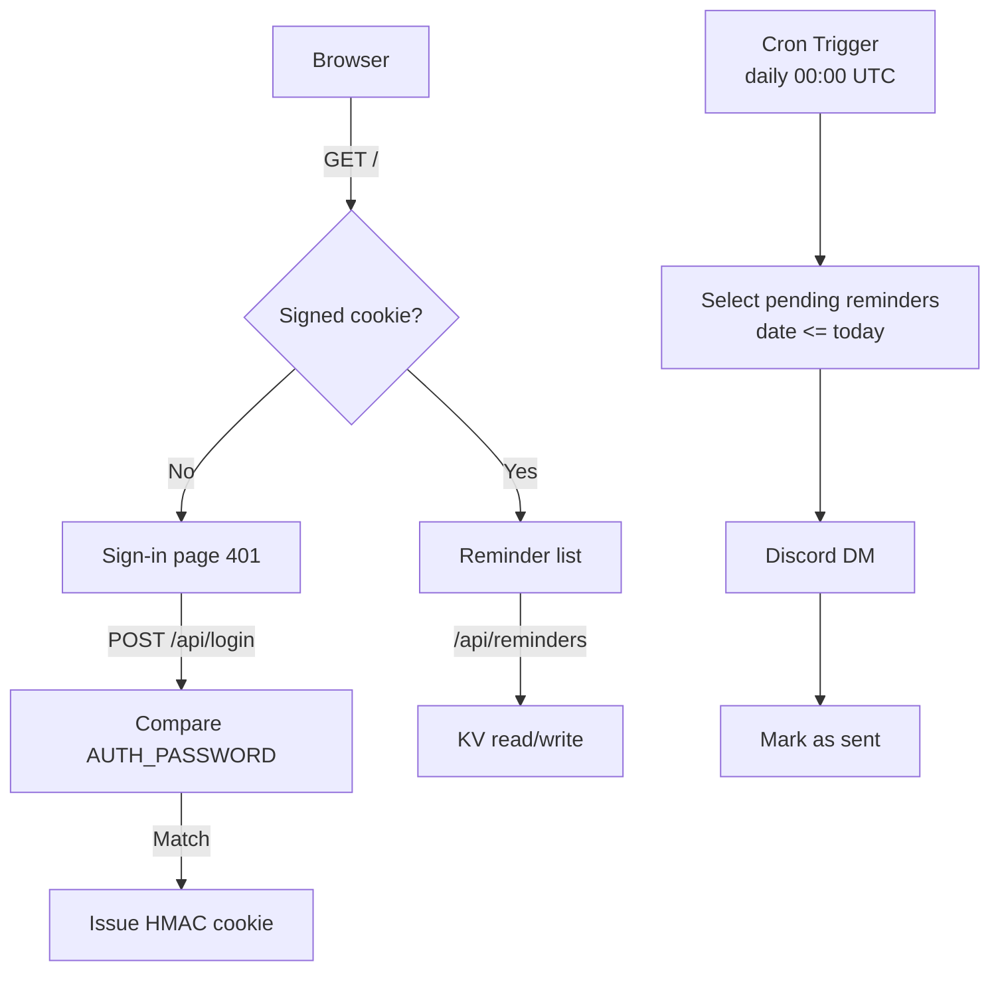

# Reminder Bot

A self-hosted reminder app that lives entirely on Cloudflare. Add a date and a note in a small web UI; on that day you get a Discord DM. No servers, no database, no build step.


## Features

- **Date-based reminders** — one date and one line of text. No times, no recurrence rules.
- **Discord DMs** — reminders arrive as a private message from your own bot, so nothing is posted into a server channel.
- **Daily schedule check** — a cron trigger runs once a day and sends everything that is due.
- **Overdue catch-up** — if the scheduled run is missed, due reminders are sent on the next run instead of being skipped.
- **Password-protected UI** — a single password issues a signed session cookie. No accounts, no user table.
- **Idempotent delivery** — a reminder is marked sent before the next run, so a duplicate trigger never sends twice.
- **Free-tier friendly** — runs within the Workers free plan and needs one KV namespace.
- **No dependencies** — one Worker, ~200 lines of JavaScript, no bundler and no npm packages at runtime.

## How it works



**Components**

| Piece | Role |
| --- | --- |
| `src/index.js` | Worker: auth, REST API, delivery logic, `scheduled()` handler |
| `src/ui.js` | HTML for the sign-in and reminder pages, with inlined CSS/JS |
| Workers KV | Storage — one key per reminder |
| Cron Trigger | Daily run at 00:00 UTC |
| Discord Bot API | Delivers the DM |

**Storage layout.** Each reminder is a separate KV entry (`reminder:<id>`) holding `{ id, date, text, done, createdAt, sentAt }`. Listing uses a prefix scan. Storing one key per reminder rather than a single JSON document means concurrent writes cannot clobber each other, and no read-modify-write cycle is needed.

**Time handling.** All date comparisons use `YYYY-MM-DD` strings derived from UTC+8, never `Date` arithmetic. A reminder is due when its date is less than or equal to today's date in that timezone.

**Delivery is idempotent.** `runReminders()` selects only entries with `done: false`, sends each one, then flips `done` to `true`. Running the job twice in a row sends nothing the second time.

## Deploy

### Prerequisites

- A Cloudflare account with Workers enabled
- Node.js 18 or later (`npx wrangler`)
- A Discord application with a bot token

### 1. Create the Discord bot

1. Open the [Discord Developer Portal](https://discord.com/developers/applications) and create a new application.
2. Under **Bot**, create the bot and copy its token.
3. Note the numeric user ID of the person who should receive the DMs. Enable **Developer Mode** in Discord, then right-click your avatar and choose **Copy User ID**.

The bot does not need any privileged gateway intents — it only makes outbound REST calls. It also does not need to be invited to a server, because it DMs a user directly.

### 2. KV namespace

Nothing to do. The namespace is provisioned automatically on the first deploy.

`wrangler.toml` declares the binding with no `id`:

```toml
[[kv_namespaces]]
binding = "REMINDERS"
```

When wrangler deploys a binding that has no `id`, it creates a namespace named `<worker-name>-<binding>` — `reminder-bot-reminders` for this project — and records the ID against the Worker. Every later deploy, including each Workers Builds run, resolves the same namespace and reuses it. Your data is not affected by redeploying.

The lookup is by deploy history, not by name: wrangler does not scan the account for a namespace with a matching title. If a namespace with that title already exists but is not bound to this Worker, the deploy stops with:

```
a namespace with this account ID and title already exists [code: 10014]
```

That happens when a previous attempt created the namespace but failed before binding it, or when you created one manually. Either bind the existing namespace by adding its `id`, or delete the orphaned namespace and deploy again.

If you would rather manage the namespace yourself, create one and pin it:

```sh
npx wrangler kv namespace create REMINDERS
```

```toml
[[kv_namespaces]]
binding = "REMINDERS"
id = "<the id wrangler printed>"
```

### 3. Configure the project

`wrangler.toml` is committed, because Workers Builds needs it in the repository to deploy:

```toml
name = "reminder-bot"
main = "src/index.js"
compatibility_date = "2026-10-07"

[triggers]
crons = ["0 0 * * *"]        # 00:00 UTC = 08:00 in UTC+8

[[kv_namespaces]]
binding = "REMINDERS"
```

Keep `account_id` and a `[[routes]]` block out of this file if you plan to publish the repository: the account ID is available to Cloudflare's build environment, and a committed route would expose your domain. Bind a custom domain from the dashboard instead.

If your scheduling needs differ, adjust the cron expression. It runs in UTC.

### 4. Set the secrets

Four secrets are read from the environment and none of them belong in the repository.

```sh
npx wrangler secret put AUTH_PASSWORD    # password for the web UI
npx wrangler secret put AUTH_SECRET      # random string used to sign session cookies
npx wrangler secret put DISCORD_TOKEN    # bot token from step 1
npx wrangler secret put DISCORD_USER_ID  # recipient's numeric user ID
```

Generate `AUTH_SECRET` with:

```sh
openssl rand -base64 32
```

### 5. Deploy

```sh
npx wrangler deploy
```

Wrangler prints the URL of your Worker, for example `https://reminder-bot.<your-subdomain>.workers.dev`. Open it and sign in with `AUTH_PASSWORD`.

### 6. Optional: bind a custom domain

Bind it from the Cloudflare dashboard under **Workers & Pages → your Worker → Settings → Domains & Routes**. The zone must be in the same Cloudflare account.

If your repository is private, you can instead add a route to `wrangler.toml` and redeploy:

```toml
[[routes]]
pattern = "reminders.example.com"
custom_domain = true
```

Removing a `[[routes]]` block does not detach an existing custom domain from the Worker — the binding persists until you remove it in the dashboard.

## Local development

Create a `.dev.vars` file with the same four variables. It is already in `.gitignore`.

```sh
npx wrangler dev --local
```

To exercise the scheduled path locally, run the dev server with `--test-scheduled` and invoke the `scheduled()` handler directly:

```sh
npx wrangler dev --local --test-scheduled
curl "http://localhost:8787/__scheduled?cron=0+0+*+*+*"
```

## API

All endpoints except `/api/login` require a valid session cookie.

| Method | Path | Purpose |
| --- | --- | --- |
| `POST` | `/api/login` | Exchange `{ password }` for a session cookie |
| `POST` | `/api/logout` | Clear the session cookie |
| `GET` | `/api/reminders` | List reminders plus today's date |
| `POST` | `/api/reminders` | Create one from `{ date, text }` |
| `DELETE` | `/api/reminders/:id` | Delete one |
| `POST` | `/api/test` | Send a test DM to confirm the bot works |

## Configuration reference

| Name | Kind | Purpose |
| --- | --- | --- |
| `AUTH_PASSWORD` | secret | Web UI password |
| `AUTH_SECRET` | secret | HMAC key for session cookies; rotating it signs everyone out |
| `DISCORD_TOKEN` | secret | Bot token used to open a DM channel and post the message |
| `DISCORD_USER_ID` | secret | Sole recipient of every reminder |
| `REMINDERS` | KV binding | Reminder storage; provisioned automatically on first deploy |

Sessions last 30 days. The cookie is `HttpOnly`, `Secure`, and `SameSite=Lax`, and its value is `expiry.HMAC-SHA256(expiry)` — verification recomputes the MAC and compares it in constant time, so nothing is stored server-side.

## Scheduling notes

Cron Triggers work, but a schedule that is **created or modified** can fail to activate. Cloudflare has acknowledged this more than once:

- [Cron Trigger Activation Issues](https://www.cloudflarestatus.com/incidents/cbvocc87nsne) — 13 Oct 2026
- [Cron Trigger Activation Issues](https://www.cloudflarestatus.com/incidents/npjny9agana8) — 14 Oct 2026

The official wording: schedules that have *not* been recently modified are unaffected. Symptoms are a registered trigger, a deployed `scheduled()` handler, and zero invocations.

Both incidents are resolved as of 15 Oct 2026 and cron is verified working. Cloudflare's resolution notes that "some schedule redeploys may be required for a small fraction of Workers who were impacted during the incident" — so if you deployed while one of these incidents was open, redeploy once to re-register the trigger.

If your reminders are not arriving:

1. Check [cloudflarestatus.com](https://www.cloudflarestatus.com) for an open incident.
2. Confirm the schedule is registered: `npx wrangler deployments status`.
3. Redeploy to re-register the trigger, then allow up to 15 minutes for propagation.

Because re-registering a trigger is what can break it, avoid redeploying repeatedly while waiting. Note that each redeploy restarts the propagation window.

You can verify dispatch directly with the GraphQL Analytics API, which reports scheduled invocations separately from HTTP requests:

```graphql
query {
  viewer {
    accounts(filter: { accountTag: "<account-id>" }) {
      workersInvocationsScheduled(
        limit: 100
        filter: { scriptName: "reminder-bot", datetime_geq: "<start>", datetime_leq: "<end>" }
      ) {
        scriptName
        cron
        datetime
        status
      }
    }
  }
}
```

An empty result with a registered trigger points at the platform, not at your code.

## Limitations

- One user, one recipient. `DISCORD_USER_ID` receives everything.
- Dates only — no times of day. Everything is sent in the daily run.
- Overdue reminders are sent on the next run, so a reminder dated in the past is delivered rather than skipped.
- KV is eventually consistent, so a newly added reminder may take a moment to appear in a second browser tab. The UI keeps its own state after a write, so the tab you are using updates immediately.

## License

MIT
