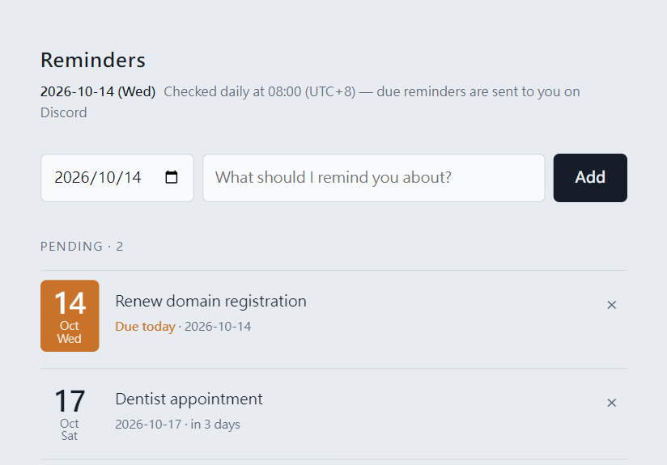
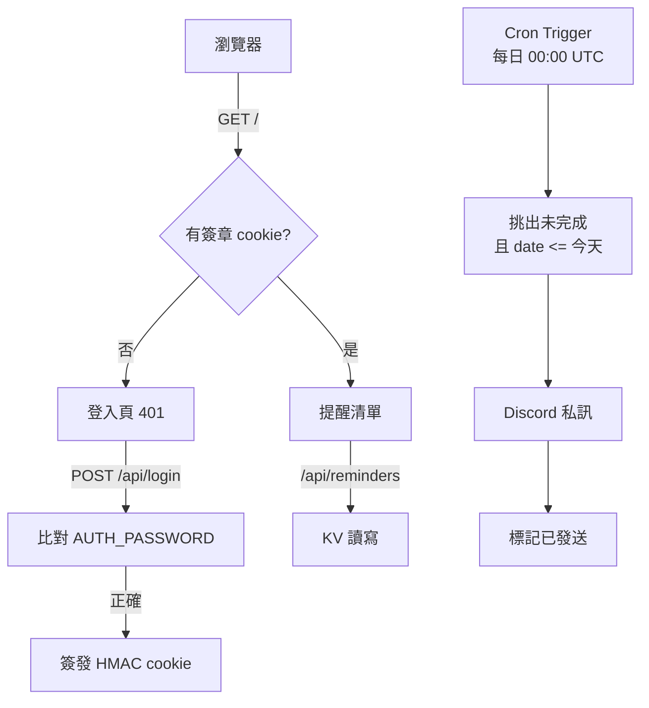

# Reminder Bot

[English](README.md) | 繁體中文

完全跑在 Cloudflare 上的自架提醒工具。在小巧的網頁介面輸入日期和事項，當天就會收到 Discord 私訊。不用伺服器、不用資料庫、不用建置流程。



## 功能

- **日期提醒** — 一個日期、一行文字，沒有時間也沒有重複規則。
- **Discord 私訊** — 提醒以私訊送達，不會洗版任何伺服器頻道。
- **每日排程檢查** — 每天執行一次，發送所有到期項目。
- **逾期補送** — 排程漏跑時，到期項目會在下一次執行補送，不會被跳過。
- **密碼保護介面** — 單一密碼換取簽章 session cookie，沒有帳號系統、沒有使用者表。
- **冪等發送** — 發送後立即標記，重複觸發不會重送。
- **免費方案可用** — 在 Workers 免費額度內運作，只需一個 KV namespace。
- **零依賴** — 一個 Worker、約 200 行 JavaScript，執行期不需 bundler 或 npm 套件。

## 運作方式



**組成**

| 檔案／服務 | 角色 |
| --- | --- |
| `src/index.js` | Worker：認證、REST API、發送邏輯、`scheduled()` handler |
| `src/ui.js` | 登入頁與提醒頁的 HTML，CSS/JS 內嵌 |
| Workers KV | 儲存，每則提醒一個 key |
| Cron Trigger | 每天 00:00 UTC 執行 |
| Discord Bot API | 發送私訊 |

**儲存結構**：每則提醒是獨立的 KV 項目（`reminder:<id>`），內容為 `{ id, date, text, done, createdAt, sentAt }`，列表用前綴掃描。一則一個 key 而非單一 JSON 文件，可避免並發寫入互相覆蓋，也不需要讀-改-寫循環。

**時間處理**：所有日期比較都用 UTC+8 算出的 `YYYY-MM-DD` 字串，不用 `Date` 運算。當提醒日期小於等於該時區的今天，即為到期。

**發送具冪等性**：`runReminders()` 只挑 `done: false` 的項目，發送後把 `done` 設為 `true`。連續執行兩次，第二次不會發送任何訊息。

## 部署

### 前置需求

- 已啟用 Workers 的 Cloudflare 帳號
- Node.js 18 以上
- 一個帶 bot token 的 Discord 應用程式

以下步驟使用 `npx wrangler`，第一次執行時會自動下載 Wrangler——本專案沒有 `package.json`，不需要安裝任何東西。部署前先登入一次：

```sh
npx wrangler login
```

這會開啟瀏覽器授權存取你的 Cloudflare 帳號。若你想全部改用 dashboard 操作，可跳過此步，直接看本節最後的[不用 Wrangler 的部署方式](#不用-wrangler-的部署方式)。

### 1. 建立 Discord bot

1. 開啟 [Discord Developer Portal](https://discord.com/developers/applications)，建立新的應用程式。
2. 在 **Bot** 頁面建立 bot，複製 token。
3. 記下要接收私訊者的數字使用者 ID：在 Discord 開啟**開發者模式**，右鍵點自己的頭像，選**複製使用者 ID**。

bot 不需要任何特權 gateway intent，因為它只發出 REST 請求；也不需要邀請進伺服器，因為它是直接私訊使用者。

### 2. KV namespace

不用做任何事。namespace 會在第一次部署時自動建立。

`wrangler.toml` 只宣告 binding，不給 `id`：

```toml
[[kv_namespaces]]
binding = "REMINDERS"
```

當 wrangler 部署一個沒有 `id` 的 binding 時，會建立名為 `<worker 名稱>-<binding>` 的 namespace（本專案是 `reminder-bot-reminders`），並把 ID 記錄在該 Worker 上。之後每一次部署（包含每次 Workers Builds）都會解析到同一個 namespace 並沿用，重新部署不會影響資料。

查找依據是**部署記錄，不是名稱**：wrangler 不會去掃描帳號裡有沒有同名 namespace。若該名稱的 namespace 已存在、但沒有綁定到這個 Worker，部署會中止並顯示：

```
a namespace with this account ID and title already exists [code: 10014]
```

這種情況發生在：先前嘗試已建立 namespace 但綁定前就失敗，或你自己手動建過一個。解法是把現有 namespace 的 `id` 填進去綁定，或刪掉那個孤立的 namespace 再重新部署。

若你想自己管理 namespace，可以建立後明確綁定：

```sh
npx wrangler kv namespace create REMINDERS
```

```toml
[[kv_namespaces]]
binding = "REMINDERS"
id = "<wrangler 印出的 id>"
```

### 3. 設定專案

`wrangler.toml` 有進版控，因為 Workers Builds 需要在 repo 裡讀到它才能部署：

```toml
name = "reminder-bot"
main = "src/index.js"
compatibility_date = "2026-10-07"

[triggers]
crons = ["0 0 * * *"]        # 00:00 UTC = UTC+8 的 08:00

[[kv_namespaces]]
binding = "REMINDERS"
```

若打算公開這個 repo，不要在此檔加入 `account_id` 或 `[[routes]]` 區塊——帳號 ID 對 Cloudflare 的建置環境是可得的，而 commit 進去的 route 會暴露你的網域。請改從 dashboard 綁定自訂網域。

若排程需求不同，調整 cron 表達式即可，它以 UTC 為準。

### 4. 設定 secrets

程式會從環境讀取四個 secret，都不應進版控。

```sh
npx wrangler secret put AUTH_PASSWORD    # 網頁介面密碼
npx wrangler secret put AUTH_SECRET      # 簽章 session cookie 用的隨機字串
npx wrangler secret put DISCORD_TOKEN    # 步驟 1 的 bot token
npx wrangler secret put DISCORD_USER_ID  # 收件人的數字使用者 ID
```

產生 `AUTH_SECRET`：

```sh
openssl rand -base64 32
```

### 5. 部署

```sh
npx wrangler deploy
```

Wrangler 會印出 Worker 網址，例如 `https://reminder-bot.<你的子網域>.workers.dev`。開啟後用 `AUTH_PASSWORD` 登入。

### 6. 選用：綁定自訂網域

從 Cloudflare dashboard 的 **Workers & Pages → 你的 Worker → Settings → Domains & Routes** 綁定。該網域所屬的 zone 必須在同一個 Cloudflare 帳號。

若你的 repo 是私有的，也可以在 `wrangler.toml` 加入 route 後重新部署：

```toml
[[routes]]
pattern = "reminders.example.com"
custom_domain = true
```

移除 `[[routes]]` 區塊**不會**解除已綁定的自訂網域——綁定會持續存在，直到你在 dashboard 移除它。

### 不用 Wrangler 的部署方式

上面所有步驟都可以改用 Cloudflare dashboard 完成。這條路徑走 Workers Builds：Cloudflare 會替你 clone repo、執行 `wrangler deploy`，並在每次 push 時自動重新部署。

先**把 repo fork 到自己的 GitHub 帳號**（或推到自己的新 repo），然後：

1. **建立 Worker。** 在 dashboard 前往 **Workers & Pages → Create application → Import a repository**，連接你的 GitHub 帳號、選擇該 repo，按 **Deploy**。

   Workers Builds 會讀取 repo 裡的 `wrangler.toml`，因此進入點、cron 排程與 KV 綁定全部來自這個已提交的檔案，不需要手動填寫。

   唯一必須保持一致的是名稱：Cloudflare 要求 dashboard 上的 Worker 名稱與 `wrangler.toml` 的 `name` 相符，也就是 `reminder-bot`。匯入時請接受這個名稱，或先把你偏好的名稱填進 `wrangler.toml` 的 `name`，再連接 repo。

2. **建立 KV namespace。** 第一次 build 會自動建立，與[步驟 2](#2-kv-namespace)相同，不需任何操作。若你想自己建立，前往 **Workers KV** 頁面，選 **Create instance**，再開啟 Worker 的 **Bindings** 分頁，選 **Add binding → KV namespace**，變數名稱填 `REMINDERS`，選取該 namespace。

3. **加入 secrets。** 開啟 Worker，前往 **Settings → Variables and Secrets**，新增四筆型別為 **Secret** 的項目：

   | 名稱 | 值 |
   | --- | --- |
   | `AUTH_PASSWORD` | 你想要的網頁介面密碼 |
   | `AUTH_SECRET` | 任何夠長的隨機字串 |
   | `DISCORD_TOKEN` | [步驟 1](#1-建立-discord-bot)的 bot token |
   | `DISCORD_USER_ID` | 收件人的數字使用者 ID |

   按 **Deploy** 套用變更。

4. **確認 cron 排程。** 前往 **Settings → Triggers → Cron Triggers**，應該會顯示 `0 0 * * *`（來自 `wrangler.toml`）。

   由於 Workers Builds 是用 Wrangler 部署，排程由 `wrangler.toml` 掌管：每次部署都會用檔案裡宣告的內容取代已註冊的 trigger。要改時間就編輯 `wrangler.toml` 的 `crons` 並 push。只在 dashboard 改的排程會被下一次部署還原。

5. **開啟 Worker 網址**（在 **Settings → Domains & Routes** 底下，除非你綁了自訂網域，否則就是 `*.workers.dev`），用 `AUTH_PASSWORD` 登入。

dashboard 的內建編輯器不能取代這套流程：它直接編輯已部署的 Worker，而不是 repo，因此下一次 Workers Builds 部署會覆蓋你在那裡儲存的內容。請把 repo 當作唯一來源：使用 Workers Builds，或在本機用 Wrangler。

## 本地開發

建立 `.dev.vars`，填入同樣四個變數（已在 `.gitignore` 中）。

```sh
npx wrangler dev --local
```

在本機測試排程路徑，請以 `--test-scheduled` 啟動 dev server，直接觸發 `scheduled()` handler：

```sh
npx wrangler dev --local --test-scheduled
curl "http://localhost:8787/__scheduled?cron=0+0+*+*+*"
```

## API

除 `/api/login` 外，所有端點都需要有效的 session cookie。

| 方法 | 路徑 | 用途 |
| --- | --- | --- |
| `POST` | `/api/login` | 用 `{ password }` 換取 session cookie |
| `POST` | `/api/logout` | 清除 session cookie |
| `GET` | `/api/reminders` | 列出提醒與今天的日期 |
| `POST` | `/api/reminders` | 用 `{ date, text }` 建立一則 |
| `DELETE` | `/api/reminders/:id` | 刪除一則 |
| `POST` | `/api/test` | 發送測試私訊，確認 bot 正常 |

## 設定項對照

| 名稱 | 類型 | 用途 |
| --- | --- | --- |
| `AUTH_PASSWORD` | secret | 網頁介面密碼 |
| `AUTH_SECRET` | secret | session cookie 的 HMAC 金鑰，換掉會讓所有人登出 |
| `DISCORD_TOKEN` | secret | 用來開啟私訊頻道並發送訊息的 bot token |
| `DISCORD_USER_ID` | secret | 所有提醒的唯一收件人 |
| `REMINDERS` | KV binding | 提醒儲存空間；第一次部署時自動建立 |

session 有效期 30 天。cookie 為 `HttpOnly`、`Secure`、`SameSite=Lax`，值為 `到期時間.HMAC-SHA256(到期時間)`；驗證時重新計算 MAC 並以固定時間比較，伺服器端不儲存任何狀態。

## 排程注意事項

Cron Trigger 可用，但**新建立或修改過**的排程可能無法啟用。Cloudflare 已多次公告此問題：

- [Cron Trigger Activation Issues](https://www.cloudflarestatus.com/incidents/cbvocc87nsne) — 2026-10-13
- [Cron Trigger Activation Issues](https://www.cloudflarestatus.com/incidents/npjny9agana8) — 2026-10-14

官方說法是：**近期未被修改**的排程不受影響。症狀為：觸發器已註冊、`scheduled()` handler 已部署，但呼叫次數為零。

這兩起事件已於 2026-10-15 解決，cron 經實測正常運作。Cloudflare 的結案說明提到「少數受影響的 Worker 可能需要重新部署排程」，因此若你是在事件期間部署的，重新部署一次以重新註冊觸發器即可。

若提醒沒有送達：

1. 先看 [cloudflarestatus.com](https://www.cloudflarestatus.com) 有無進行中的事件。
2. 確認排程已註冊：`npx wrangler deployments status`。
3. 重新部署以重新註冊觸發器，然後等最多 15 分鐘的傳播期。

由於「重新註冊」本身就可能觸發這個問題，等待期間不要反覆重新部署。注意每次重新部署都會讓傳播期重新計時。

可用 GraphQL Analytics API 直接驗證派送狀況，它會把排程呼叫與 HTTP 請求分開統計：

```graphql
query {
  viewer {
    accounts(filter: { accountTag: "<account-id>" }) {
      workersInvocationsScheduled(
        limit: 100
        filter: { scriptName: "reminder-bot", datetime_geq: "<start>", datetime_leq: "<end>" }
      ) {
        scriptName
        cron
        datetime
        status
      }
    }
  }
}
```

觸發器已註冊但查詢結果為空，指向平台問題而非程式碼問題。

## 已知限制

- 單一使用者、單一收件人，`DISCORD_USER_ID` 接收全部提醒。
- 只有日期、沒有時刻，全部在每日排程中發送。
- 逾期提醒會在下一次執行補送，因此過去的日期會被送出而非略過。
- KV 為最終一致性，剛新增的提醒在另一個分頁可能要等一下才出現；你正在操作的分頁因為維護自身狀態，會立即更新。

## 授權

MIT
